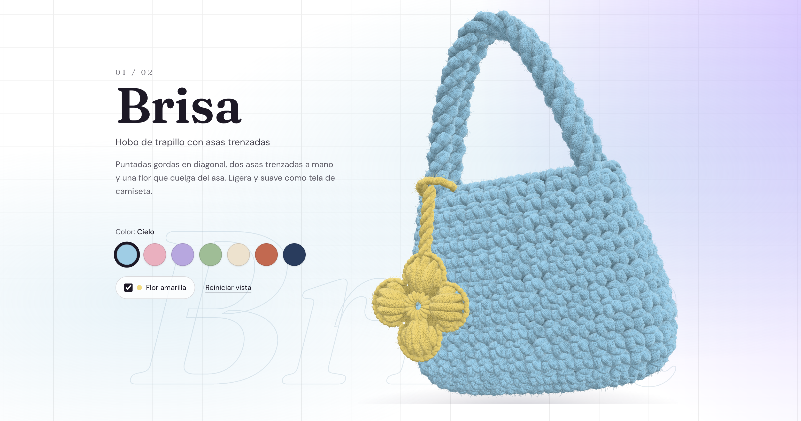

# Vellaz Crochet



Vellaz Crochet es un catálogo web interactivo de bolsos tejidos a mano. Creé el proyecto para mostrar los modelos que una clienta teje a crochet y ayudar a quien quiera encargar uno a decidir cómo le gustaría recibirlo.

La idea es que cada persona pueda elegir un bolso, girarlo para apreciar su forma y probar los colores y accesorios disponibles antes de encargarlo. Busco que la vista 3D conserve los detalles que distinguen a los bolsos reales, desde la inclinación de las puntadas hasta el brillo de cada hilo.

Este es también mi primer proyecto con Three.js. Aproveche esta idea para entender como se trabaja con esta tecnologia, he utulizanod opus 5.5 para desarrollar este modelado a base de modelos reales que la clienta proporciono, hasta este momento el proyecto esta esta en optimizaciones y detalle de modelo, dejando para el final el diseño que tendra la web.

## Qué se puede hacer hoy

| Modelo | Opciones disponibles | Referencia |
| --- | --- | --- |
| **Brisa** | Bolso hobo de trapillo con dos asas trenzadas, siete colores lisos y una flor amarilla opcional. | [Foto de Brisa](reference/brisa.png) |
| **Bombón** | Mini bolso de cinta satinada con un asa gruesa, siete combinaciones bicolor y una esfera navideña opcional. | [Foto de Bombón](reference/bombon.png) |

Puedes arrastrar el bolso para girarlo, acercarlo con un gesto de pellizco y presionar el tejido para ver cómo se hunde y recupera su forma. Los colgantes se balancean al girar el bolso y reaccionan al tocarlos. El botón **Reiniciar vista** restablece el giro y el acercamiento de la cámara.


## Tecnologías y estructura

- **Astro** organiza la página y la portada. El catálogo se monta en el navegador como una isla de **React**, que mantiene la selección de colores y accesorios de cada bolso.
- **Three.js** genera la geometría, los materiales y la iluminación. **React Three Fiber** integra la escena en React mediante `Canvas` y ofrece `useFrame` para actualizarla en cada fotograma.
- **TypeScript** define los tipos del catálogo y de los modelos. **Tailwind CSS** da estilo a la interfaz y **GSAP con ScrollTrigger** coordina las animaciones ligadas al desplazamiento.

```text
src/
├── pages/index.astro       # Portada y punto de entrada del catálogo
├── layouts/                # Estructura HTML compartida
├── components/             # Catálogo, fichas y controles de personalización
├── data/                   # Bolsos, paleta de hilos y combinaciones
├── types/                  # Tipos compartidos del catálogo
├── styles/                 # Estilos globales
└── three/
    ├── BagCanvas.tsx       # Escena, cámara e iluminación de cada bolso
    ├── InteractiveStage.tsx # Giro, acercamiento y presión sobre el tejido
    ├── registry.ts         # Vincula el catálogo con modelos y accesorios
    ├── models/             # Recetas de Brisa y Bombón y constructor común
    ├── extras/             # Colgantes y su comportamiento
    └── lib/                # Formas, puntadas, materiales, texturas y física
public/                    # Recursos públicos de la web
reference/                 # Fotos de los bolsos y boceto de interacción
```

Cada ficha del catálogo define qué colores y accesorios se pueden elegir. Los colores parten de una paleta de hilos, a partir de la cual se crean las opciones lisas y bicolor. El `modelKey` conecta cada ficha con su receta 3D, que define la silueta, la separación y la inclinación de las puntadas, el acabado del hilo y la forma de las asas. Ver [`bags.ts`](src/data/bags.ts), [`yarns.ts`](src/data/yarns.ts), [`colorways.ts`](src/data/colorways.ts) y [`registry.ts`](src/three/registry.ts).

## Cómo uso Three.js

### Construir el tejido puntada a puntada

`KnitBag` calcula las posiciones de las puntadas sobre el cuerpo, construye las asas a lo largo de curvas y reúne las piezas en un `THREE.Group`. Aprendí a usar `THREE.InstancedMesh` para repetir una geometría con distintas posiciones, orientaciones y escalas. Así puedo dar volumen a las puntadas con menos llamadas de dibujo que si cada una fuera una malla independiente. Ver [`KnitBag.tsx`](src/three/models/KnitBag.tsx).

En `createInstanced`, cada puntada recibe su propia matriz de transformación y una ligera variación de tono. Ver [`stitches.ts`](src/three/lib/stitches.ts).

```ts
const mesh = new THREE.InstancedMesh(geometry, material, matrices.length);
const tone = new THREE.Color();

matrices.forEach((matrix, index) => {
  mesh.setMatrixAt(index, matrix);
  tone.setScalar(1 - random() * toneVariation);
  mesh.setColorAt(index, tone);
});

mesh.instanceMatrix.needsUpdate = true;
if (mesh.instanceColor) mesh.instanceColor.needsUpdate = true;
```

### Cambiar los colores y conservar el detalle del hilo

El trapillo mate de Brisa y la cinta satinada de Bombón usan un `MeshPhysicalMaterial` con mapas generados por código. El albedo aporta variaciones de tono, el mapa de normales simula el microrrelieve y la rugosidad ayuda a definir cómo se refleja la luz. Una capa de fibras finas añade pelusa visible en el contorno. El código está en [`fabric.ts`](src/three/lib/fabric.ts), [`yarnTexture.ts`](src/three/lib/yarnTexture.ts) y [`fuzz.ts`](src/three/lib/fuzz.ts).

Aprendí a extender el shader del material con `onBeforeCompile` y a pasarle los dos tonos como valores uniformes. El shader los distribuye en espiral dentro de cada puntada bicolor. Si se elige un color liso, usa el mismo tono para ambos. Este fragmento adaptado de `KnitBag.tsx` muestra cómo se suaviza el cambio de color al actualizar esos valores con `useFrame`, manteniendo la misma geometría.

```tsx
useFrame((_, delta) => {
  targetA.set(tones[0]!);
  targetB.set(tones[1] ?? tones[0]!);
  const blend = 1 - Math.exp(-7 * delta);

  built.yarnTones.uToneA.value.lerp(targetA, blend);
  built.yarnTones.uToneB.value.lerp(targetB, blend);
});
```

### Darle movimiento al bolso

Uso cuaterniones para girar el bolso con inercia. `THREE.Raycaster` proyecta un rayo desde la cámara en la dirección del puntero y detecta dónde toca el modelo. Ese punto se pasa al shader, que hunde los vértices cercanos. Al soltar, un resorte amortiguado devuelve el tejido a su forma. Los accesorios usan un péndulo que responde a la gravedad y al giro, con una restricción para limitar cuánto se acerca el colgante al cuerpo del bolso. Ver [`InteractiveStage.tsx`](src/three/InteractiveStage.tsx), [`softPress.ts`](src/three/lib/softPress.ts) y [`pendulum.ts`](src/three/lib/pendulum.ts).

### Controlar el costo del renderizado

El código 3D se carga por separado de la interfaz. El canvas de cada bolso se monta cuando su sección se acerca al área visible y se desmonta cuando queda lejos. Entre ambos puntos, el renderizado se pausa cuando el visor sale del margen de visibilidad. También reduzco la resolución de las texturas, la densidad de fibras y la resolución de renderizado en dispositivos que reportan un puntero de baja precisión, como muchas pantallas táctiles.

